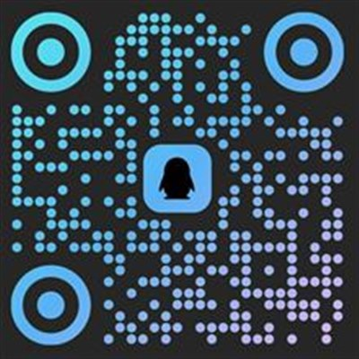

# CarMedia（蓝牙音乐媒体桥接）

<div align="center">


**米小江**

QQ：361955274　|　QQ 交流群：917274937　|　[GitHub](https://github.com/q361955274)

</div>

面向 eCarX（亿咖通）Android 9 车机的系统级媒体桥接应用：监听系统媒体会话与通知栏，把歌名、歌手、歌词、进度与播放状态归一化后推送到 EAS 媒体中心，驱动车机桌面小卡片与仪表盘显示，并提供音源切换、方向盘按键映射、歌词抓取与本地播放等能力。

- 包名：`com.ecarx.carmedia`，桌面显示名「蓝牙音乐」
- 当前版本：1.6.8（versionCode 33）
- 适用平台：eCarX / GKUI 系列 Android 9（API 28）车机

---

## 功能特性

### 媒体桥接与展示

- 通过 eCarX EAS（MediaCenter）注册为系统媒体源，向桌面小卡片与仪表盘推送播放状态、元数据、歌词与进度
- WebView 主界面展示当前音源、歌名、歌手、歌词行与进度，支持播放 / 暂停、上下曲与进度条操作
- 封面提取：从控制器元数据、网络封面接口与本地缓存多级兜底，通过 ContentProvider 共享给系统组件

### 多音源控制器

- 自动发现并切换当前播放音源，支持手动选择与按音源屏蔽
- 已对接的音源类型：蓝牙 AVRCP、网易云音乐 / 网易云 IoT、QQ 音乐车机版、汽水音乐（车机版 / 手机版）、酷我音乐（标准版与 GKUI 定制版）、酷狗音乐车机版 / 概念版、USB 本地音乐
- 对 MediaSession 状态不可靠的音源，结合音频轨真实活动状态校准播放判定，避免误切音源

### 歌词抓取

- 多源容错链路：QQ 音乐车机版 AIDL 直连、酷我 AIDL 与加密网络接口、网易云 HTTP 搜索、汽水音乐接口、云端第三方兜底、通知栏内嵌歌词、音频文件内嵌歌词
- 归属校验：按歌名 / 歌手匹配过滤误匹配歌词；支持按控制器屏蔽歌词接口调用
- 统一 LRC 解析与文本归一化，过期结果按序号丢弃，避免旧线程晚到覆盖当前歌词

### 方向盘按键

- 方向盘媒体键拦截与单击 / 双击 / 长按动作分发，支持自定义按键映射与打开指定应用
- OK 键等无法走标准按键通道的按键，通过 HAL 日志监听兜底捕获
- 按键录制在 WebView 界面完成，映射关系本地持久化

### 后台保活与本地播放

- 开机自启（含直接可用启动阶段），前台服务常驻，通知监听服务作为保活锚点
- USB 音乐扫描与本地播放，作为独立音源接入控制器体系
- 通知监听服务作为权威数据源，歌名 / 歌手 / 歌词以通知信息为准，不被其他来源覆盖

### 更新机制

- `ui.html` 主界面支持通过可配置的远程渠道热更新（需自备仓库与访问凭证），更新后本地加载优先，失败回退内置资源
- 支持远程版本清单检测、APK 直链下载与安装，可选 MD5 校验；安装通过专属 ContentProvider 共享文件

---

## 技术架构

整体分为三层：采集归一化、业务核心、界面与推送。

```
音源 App / 蓝牙 / USB
        │ MediaSession · 通知栏 · AIDL · 广播
        ▼
┌─────────────────────────────────────────┐
│ CarMediaService（前台服务，单一事实源）    │
│  控制器管理 · 状态归一化 · 歌词链路 · 按键分发 │
└───────┬───────────────────────┬─────────┘
        │                       │
        ▼                       ▼
  EAS MediaCenter          MainActivity（WebView）
  小卡片 / 仪表盘推送       JsBridge ↔ ui.html
```

- **EAS 单链路推送**：业务核心只向 EAS MediaCenter 推送一份归一化数据；桌面小卡片由 MediaCenter UI 消费，仪表盘（DIM）由系统内部同一链路自动转发，无需单独实现仪表盘适配接口。
- **UI 与业务分离**：`MainActivity` 只做 WebView 容器与 JsBridge 转发，不持有业务状态；界面逻辑全部位于 `assets/ui.html`，可独立热更新。
- **数据源优先级**：通知栏信息优先于 MediaSession 元数据；播放是否真实进行以音频轨活动状态为准；歌词按 AIDL 直连 → 云端搜索 → 内嵌 / 通知歌词的顺序逐级兜底，命中后经归属校验再上屏。
- **EAS SDK 与接口**：工程内内置 EAS Framework、MediaCenter 相关 AIDL 接口与消息类，为适配车机框架反编译移植，命名空间位于 `com.ecarx.eas`、`com.ecarx.sdk`、`ecarx.xsf.mediacenter` 下。
- **凭据与配置**：所有敏感配置不入库，构建时从根目录 `local.properties` 读取并注入；仓库仅提交 `local.properties.example` 占位示例。注入项包括：`ecarx.appId` / `ecarx.appKey`（经 `manifestPlaceholders` 写入清单）、`carmedia.updateUrl`（写入 `BuildConfig.UPDATE_URL`）、`gh.owner` / `gh.repo` / `gh.token`（写入 `BuildConfig.GITHUB_OWNER` / `GITHUB_REPO` / `GITHUB_TOKEN`），以及本地 SDK 路径 `sdk.dir`。未配置时使用缺省占位符，项目仍可编译；具体取值方式见 `docs/` 内重建指引的「凭据」章节。

---

## 构建与运行

### 构建环境

| 项 | 值 |
|---|---|
| JDK | 17 |
| Gradle | 8.7（wrapper） |
| Android Gradle Plugin | 8.5.2 |
| compileSdk | 34 |
| minSdk / targetSdk | 28 / 28 |
| namespace | `com.ecarx.carmedia` |
| versionName / versionCode | 1.6.8 / 33 |

首次构建前，复制 `local.properties.example` 为 `local.properties`，填入本机 SDK 路径；EAS 凭据、更新地址与热更新仓库配置为可选项，不填也能编译。

```powershell
.\gradlew.bat assembleDebug --offline
# 产物：app\build\outputs\apk\debug\app-debug.apk
```

未填写凭据时项目仍可编译通过，EAS 鉴权、热更新与在线更新会安全降级：热更新不发起网络请求并回退内置 `assets/ui.html`，在线更新检查失败不影响主功能。

### 安装与签名说明

- 普通 debug 签名的包可安装到普通 Android 设备用于界面与非系统链路调试；
- 本应用声明 `android:sharedUserId="android.uid.system"`，并依赖 eCarX OpenAPI 系统权限、通知监听、日志读取、事件注入、安全设置写入等系统级能力；要安装到车机系统分区、覆盖安装原车媒体应用并使全部链路生效，必须使用车机平台（platform）密钥重新签名；
- 使用普通 debug 签名在真车环境运行时，EAS 推送、静默安装、按键与日志相关能力不可用或静默降级；
- 覆盖安装前如设备上已存在其他签名的同名应用，需先卸载旧版本，否则会因签名不一致安装失败。

完整的架构说明、组件清单、踩坑记录与签名步骤见 [`docs/CarMedia-从零重构建修改指引.md`](docs/CarMedia-从零重构建修改指引.md)。

---

## 目录结构

```
CarMedia/
├── app/
│   ├── build.gradle
│   └── src/main/
├── docs/
├── gradle/
├── build.gradle
├── settings.gradle
├── gradle.properties
├── local.properties.example
├── gradlew
├── gradlew.bat
├── .gitignore
└── README.md
```

`local.properties` 为本机私有配置（已被忽略，不入库）；`app/src/main/` 下包含 `AndroidManifest.xml`、业务与 SDK 的 Java 源码、`assets/ui.html` 主界面资源，以及 `res/` 图标、布局与资源文件。

---

## 兼容性与已知限制

- 本工程面向 eCarX / GKUI 定制的 Android 9 车机平台；EAS MediaCenter、仪表盘转发、系统权限在非 eCarX 设备上不存在，相关链路会静默返回或降级。
- 各音乐 App 的 MediaSession 与私有 AIDL 实现不一致：部分音源的播放状态、进度不可靠，需要本地累加与音频轨状态校准；部分音源不提供封面或歌词接口，对应能力会缺失。
- 云端歌词依赖第三方公开接口，可能限流、调整或失效；同名不同歌手的歌曲存在误匹配可能，归属校验只能尽力拦截。
- 车机 ROM 版本、音源版本差异可能导致适配偏差；普通设备或模拟器无法覆盖真车 EAS 推送、方向盘按键、蓝牙 A2DP 等链路的验证。
- 热更新与在线更新的远端地址、仓库与访问凭证需自行准备，默认工程不附带可用的更新渠道。

---

## 免责声明

本项目为个人学习研究用途的**非官方**改造作品，与吉利、亿咖通、eCarX 及各音乐应用官方无任何隶属或授权关系；相关商标、接口与数据归属对应权利人。

应用申请了多项高权限能力，包括但不限于系统共享 UID、事件注入（`INJECT_EVENTS`）、安全设置写入（`WRITE_SECURE_SETTINGS`）、日志读取（`READ_LOGS`）、应用安装 / 删除、强制停止应用等。在车机上启用或误用这些能力，可能导致系统异常、设备变砖或失去保修，由此产生的一切后果由操作者自行承担。

本仓库内容仅供学习交流，请勿用于商业分发或任何违法行为；装车、替换系统应用前请自行确认风险与车辆保修条款。

---

## 赞赏与交流

如果这个项目帮你省了点时间，可以请作者喝杯咖啡；扫码时按备注留言即可。

<table align="center">
  <tr>
    <td align="center"><br />支付宝（备注：`控（**桃）`）</td>
    <td align="center"><br />微信（备注：`米小江（**桃）`）</td>
  </tr>
</table>

<div align="center">



QQ 交流群：917274937

</div>

---

## 致谢与许可

- 工程内置的 EAS Framework、MediaCenter AIDL 接口与消息类移植自车机系统框架；对 QQ 音乐、酷我、酷狗、汽水音乐、网易云等音源私有接口的对接实现，相关商标、接口协议与数据均归对应权利人所有。
- 当前仓库**未附带正式开源许可证**；源码与资源仅供学习交流，未经授权不得商用、二次分发或用于营利场景。
- 若后续计划正式公开发布，建议先清理凭据依赖，并在 MIT、Apache-2.0 等协议中选择其一补充明确许可证；第三方接口与 SDK 的使用需另行确认其授权边界。
